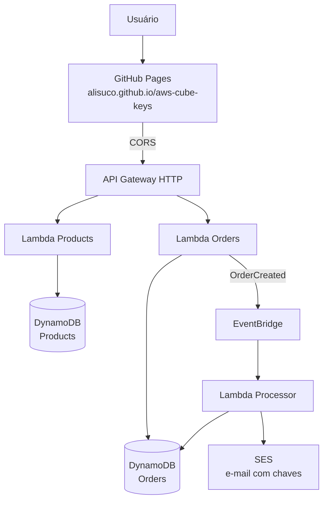

# Cube Keys — Commerce serverless na AWS

Loja headless de chaves de jogos. O **front é estático no GitHub Pages** e o **backend é serverless na AWS**, com catálogo e pedidos no DynamoDB, processamento assíncrono orientado a eventos e infraestrutura definida em AWS CDK.

> Status: Etapas 1 a 6 implementadas. O deploy (Etapa 7) ainda não foi feito. Progresso detalhado em [`PLANO.md`](PLANO.md).

## Arquitetura



Decisões principais:
- O front é publicado pelo GitHub Pages, sem servidor e sem build.
- A URL da API fica em `frontend/assets/js/config.js` (`window.CUBE_API_BASE_URL`). Ela é pública por natureza e não é segredo.
- Como front e API estão em origens diferentes, o HTTP API habilita **CORS** para `https://alisuco.github.io` (`GET`, `POST`, header `content-type`).
- API Gateway HTTP expõe as rotas consumidas por `frontend/assets/js/app.js`.
- O processamento do pedido é assíncrono: a API grava `PENDING` e publica um evento; uma Lambda separada gera as chaves, atualiza o pedido e envia e-mail.
- Catálogo e pedidos ficam no DynamoDB. O catálogo é semeado no deploy a partir de `frontend/data/products.json`, passado ao `CustomResource` no template.
- Não há CloudFront, S3 público, OAC nem domínio customizado.
- O envio por SES só acontece se `CUBE_SENDER_EMAIL` estiver definido. Sem remetente verificado, as chaves ficam disponíveis no `GET /api/orders/{orderId}`.

## Rotas da API

| Método | Rota | Descrição |
| --- | --- | --- |
| `GET` | `/api/products` | Lista o catálogo. |
| `GET` | `/api/products/{id}` | Retorna um produto. |
| `POST` | `/api/orders` | Cria pedido `PENDING` e publica o evento de processamento. |
| `GET` | `/api/orders/{orderId}` | Consulta status e chaves do pedido. |

O `POST /api/orders` recebe apenas os IDs dos produtos. Preços e chaves são definidos no servidor; o cliente não é fonte autoritativa de preço.

## Fluxo do pedido

1. O navegador envia `customer`, `paymentMethod` e `items` com IDs de produto.
2. A Lambda de pedidos valida os itens, busca os preços no DynamoDB e grava o pedido como `PENDING`.
3. A Lambda publica um evento `OrderCreated` no EventBridge e responde com `orderId`.
4. A Lambda Processor gera as chaves, atualiza o pedido para `COMPLETED` e envia as chaves por SES (quando configurado).
5. O front consulta `GET /api/orders/{orderId}` a cada 2 segundos, até no máximo 20 tentativas.

## Estrutura do repositório

- `frontend/` — site estático em HTML, CSS e JavaScript puro; publicado pelo GitHub Pages.
- `frontend/assets/js/config.js` — URL base da API; preencher após o deploy.
- `frontend/data/products.json` — catálogo usado como semente do DynamoDB.
- `infra/` — aplicação AWS CDK em TypeScript; único projeto npm do repositório.
- `infra/lib/lambdas/` — handlers das Lambdas (products, orders, processor, seed).
- `PLANO.md` — passo a passo de execução do desafio.
- `AGENTS.md` — orientações para sessões de IA no repositório.

## Pré-requisitos

- Node.js e npm.
- AWS CLI autenticada (`aws login`) com a conta/região de deploy.
- Ambiente AWS com CDK bootstrap feito.
- GitHub Pages habilitado no repositório, servindo a pasta `frontend/` (por exemplo, via branch `gh-pages` ou GitHub Actions).
- Para envio real de e-mail: endereço verificado no SES, especialmente enquanto a conta estiver no sandbox.

## Como executar e implantar

Todos os comandos abaixo são executados de dentro de `infra/`:

```powershell
npm install
npm run build
npm test
npx cdk synth
npx cdk diff
npx cdk deploy
```

`npm run build` apenas type-checka o projeto (`tsconfig.json` usa `noEmit`). O `cdk.json` já executa `npx tsc && npx tsx bin/infra.ts`, então os comandos do CDK também type-checkam antes de sintetizar.

Após o deploy, copie o domínio do Output `ProductsApiUrl` (sem o sufixo `/api/products`) para `frontend/assets/js/config.js`:

```js
window.CUBE_API_BASE_URL = 'https://xxx.execute-api.us-east-1.amazonaws.com';
```

Depois commite esse arquivo e publique o `frontend/` no GitHub Pages. A URL pública da loja será `https://alisuco.github.io/aws-cube-keys/`.

`npx cdk deploy` altera uma conta AWS real e exige autorização explícita antes de ser executado.

## Execução local do front

Abrir `index.html` diretamente com `file://` funciona para navegar pelas páginas, mas o catálogo só carrega depois que `frontend/assets/js/config.js` aponta para a API implantada. Até lá, as chamadas falham com "API_BASE_URL nao configurada".

## Entregáveis do desafio

- **Repositório GitHub**: `https://github.com/alisuco/aws-cube-keys`
- **URL pública da loja**: `https://alisuco.github.io/aws-cube-keys/`
- **Diagrama de arquitetura**: o diagrama Mermaid acima.
- **README**: este arquivo, com arquitetura e instruções de execução/implantação.
