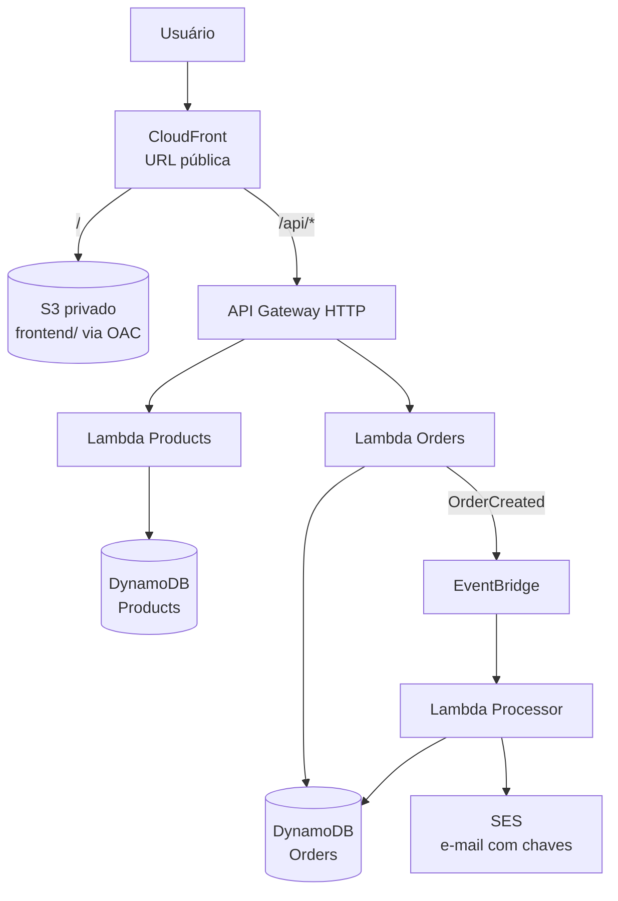

# Cube Keys — Commerce serverless na AWS

Loja headless de chaves de jogos a ser publicada na AWS com arquitetura serverless. O front é estático; o catálogo e os pedidos são servidos por uma API serverless, com processamento assíncrono orientado a eventos e infraestrutura definida em AWS CDK.

> Status: este README descreve a arquitetura-alvo. O progresso da implementação está em [`PLANO.md`](PLANO.md).

## Arquitetura



Decisões principais:
- CloudFront serve o `frontend/` a partir de um bucket S3 privado usando OAC.
- O mesmo CloudFront encaminha `/api/*` para o API Gateway, mantendo front e API na mesma origem.
- API Gateway HTTP expõe as rotas consumidas por `frontend/assets/js/app.js`.
- O processamento do pedido é assíncrono: a API grava o pedido como `PENDING` e publica um evento; uma Lambda separada gera as chaves, atualiza o pedido e envia o e-mail.
- Catálogo e pedidos ficam no DynamoDB; o catálogo é semeado a partir de `frontend/data/products.json`.
- A URL pública usa o domínio padrão do CloudFront; não há domínio customizado.

## Rotas da API

| Método | Rota | Descrição |
| --- | --- | --- |
| `GET` | `/api/products` | Lista o catálogo. |
| `GET` | `/api/products/{id}` | Retorna um produto. |
| `POST` | `/api/orders` | Cria pedido `PENDING` e publica o evento de processamento. |
| `GET` | `/api/orders/{orderId}` | Consulta status e chaves do pedido. |

O `POST /api/orders` recebe apenas os IDs dos produtos. Preços e chaves são definidos no servidor; o cliente não é fonte autoritativa de preço.

## Fluxo do pedido

1. O navegador envia `customer`, `paymentMethod` e `items` com IDs de produto.
2. A Lambda de pedidos valida os itens, busca os preços no DynamoDB e grava o pedido como `PENDING`.
3. A Lambda publica um evento `OrderCreated` no EventBridge e responde com `orderId`.
4. A Lambda Processor gera as chaves, atualiza o pedido para `COMPLETED` e envia as chaves por SES.
5. O front consulta `GET /api/orders/{orderId}` a cada 2 segundos, até no máximo 20 tentativas.

## Estrutura do repositório

- `frontend/` — site estático em HTML, CSS e JavaScript puro; não há build.
- `frontend/data/products.json` — catálogo usado como semente do DynamoDB.
- `infra/` — aplicação AWS CDK em TypeScript; é o único projeto npm do repositório.
- `PLANO.md` — passo a passo de execução do desafio.
- `AGENTS.md` — orientações para sessões de IA no repositório.

## Pré-requisitos

- Node.js e npm.
- AWS CLI configurada com a conta/região de deploy.
- Ambiente AWS com CDK bootstrap feito.
- Para envio real de e-mail: endereço verificado no SES, especialmente enquanto a conta estiver no sandbox.

## Como executar e implantar

Todos os comandos abaixo são executados de dentro de `infra/`:

```powershell
npm install
npm run build
npm test
npx cdk synth
npx cdk diff
npx cdk deploy
```

`npm run build` apenas type-checka o projeto, pois `tsconfig.json` usa `noEmit`. O `cdk.json` já executa `npx tsc && npx tsx bin/infra.ts`, então os comandos do CDK também type-checkam antes de sintetizar.

`npx cdk deploy` altera uma conta AWS real e exige autorização explícita antes de ser executado.

A URL pública aparece nos `Outputs` do stack após o deploy.

## Execução local do front

Abrir `index.html` diretamente com `file://` ou servir somente `frontend/` não carrega o catálogo, porque `app.js` consome rotas absolutas `/api/...`. Para testar, use a URL publicada ou um proxy local que encaminhe `/api` para o back-end.

## Entregáveis do desafio

- Repositório GitHub: preencher com o link final.
- URL pública da loja: copiar do `Output` do CloudFront após o deploy.
- Diagrama de arquitetura: o diagrama Mermaid acima.
- README: este arquivo, com arquitetura e instruções de execução/implantação.
